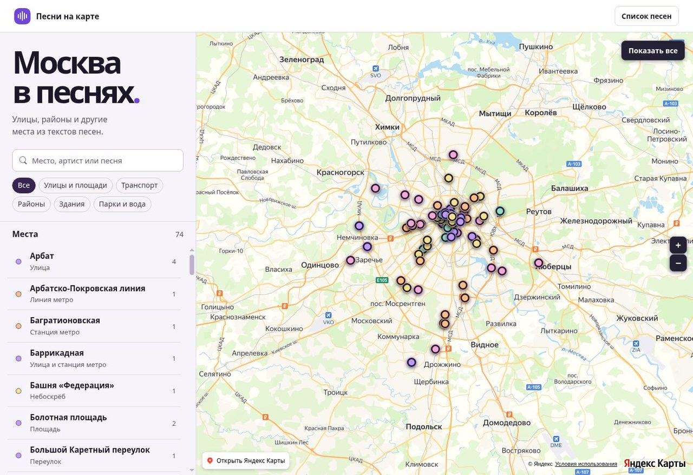

# Москва в песнях

Интерактивная карта Москвы по текстам песен. На ней можно найти улицы, станции метро, парки и здания, которые упоминают исполнители.

**[Открыть карту](https://lazysquare.github.io/moscow-song-map/)**



## Как пользоваться картой

- Найдите место, исполнителя или песню через строку поиска.
- Нажмите на метку, чтобы открыть рядом с ней отрывок, название песни, исполнителя и ссылку на Genius. Выбор места в списке приближает карту.
- В разделе **Список песен** можно перейти к местам из трека и скачать таблицу упоминаний в CSV.
- **Яндекс Карты** показывают улицы, парки и здания. Если подложка недоступна, отрывки можно открыть из списка мест.

### Парк Горького в Wind of Change

[Открыть карточку парка на карте](https://lazysquare.github.io/moscow-song-map/#place=gorky-park)


## Как редактировать песни

Откройте [catalog.json](catalog.json) и нажмите **Edit this file**. Записи находятся в массиве `songs`. Чтобы добавить трек, скопируйте запись, присвойте ей новый числовой `id` и заполните `artist`, `title` и `mentions`.

```json
{
  "id": 101,
  "artist": "Исполнитель",
  "title": "Название песни",
  "mentions": [
    {
      "place": "arbat",
      "quote": "Строка с упоминанием Арбата"
    }
  ]
}
```

Поле `place` ссылается на `id` из массива `places`. Для нового места укажите `id`, `name`, `type`, `group` и `point` в порядке **широта, долгота**. Группы — `street`, `transport`, `district`, `landmark` и `nature`. Поле `genius` принимает прямую ссылку на песню. Если оно отсутствует, в карточке появится ссылка на поиск по Genius.

Сохраните изменения через **Commit changes** в ветку `main`. Сайт обновится после сборки GitHub Pages.

## Подложка Яндекс Карт

В [кабинете разработчика Яндекса](https://developer.tech.yandex.ru/) подключите **JavaScript API**. На странице этого продукта откройте настройки ключа и укажите `lazysquare.github.io` в поле **Ограничение по HTTP Referer**. В `index.html` подставьте публичный браузерный ключ в `content` тега `meta` с именем `yandex-js-api-key`. Ключ будет виден в сетевых запросах сайта. [Документация JavaScript API](https://yandex.ru/maps-api/docs/js-api/common/quickstart.html)

## Источники и технологии

- Карта работает на [JavaScript API Яндекс Карт](https://yandex.ru/maps-api/docs/js-api/).
- Выделение линий метро построено по [координатам станций hh.ru](https://api.hh.ru/metro/1).
- В карточках песен есть ссылки на [Genius](https://genius.com/). Расположение меток для протяжённых объектов и разговорных названий может быть приблизительным.

Автор проекта — [LazySquare](https://github.com/LazySquare).
